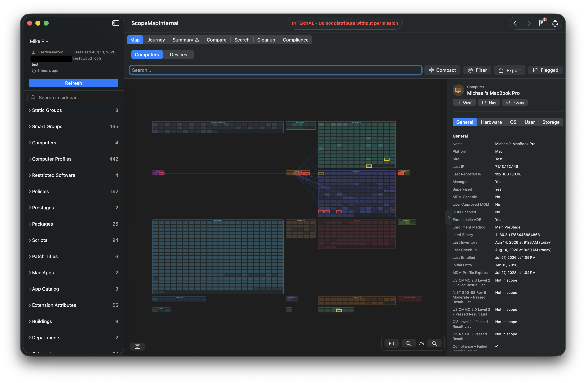
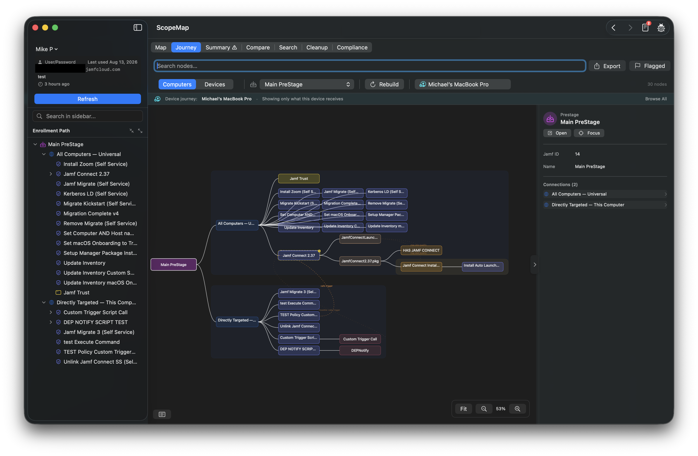
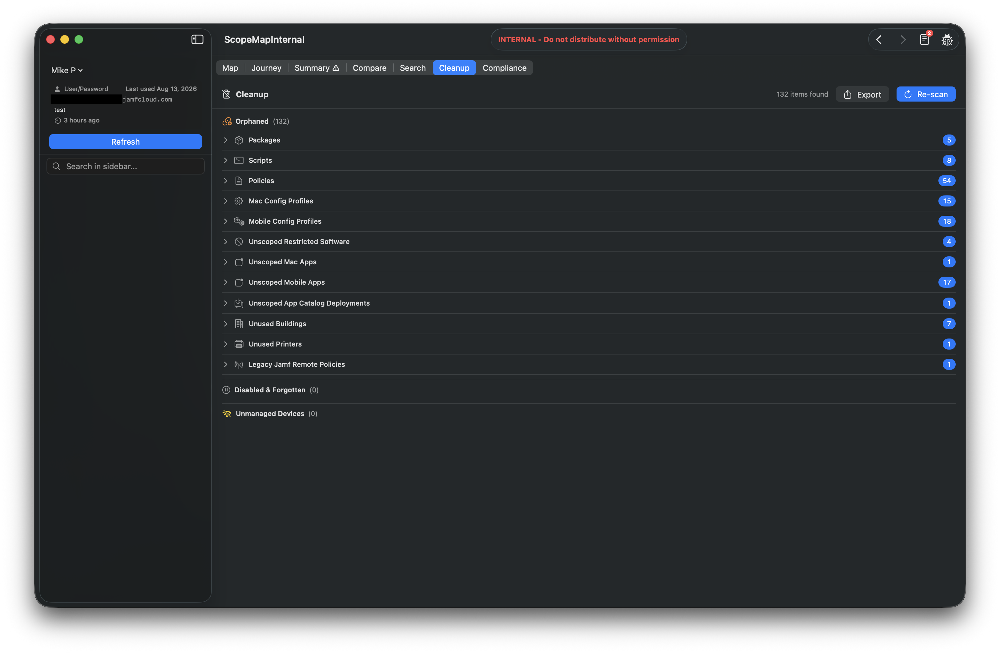

# ScopeMap

ScopeMap is a native macOS app that answers the question Jamf Pro's web interface can't: what actually reaches a device, and why. It scans a Jamf Pro environment, models every object that participates in scoping — computers and mobile devices, groups, policies, profiles, apps, packages, scripts, users, and more — and evaluates effective scope across all of them so you can see blast radius, trace a single device's delivery path, and find the cruft that's accumulated.

- [Features](#features)
- [Installing](#installing)
- [Requirements](#requirements)
- [Connecting to a server](#connecting-to-a-server)
- [API privileges](#api-privileges)
- [What ScopeMap can and can't evaluate](#what-scopemap-can-and-cant-evaluate)
- [Deleting objects (Destructive Mode)](#deleting-objects-destructive-mode)
- [Privacy and security](#privacy-and-security)
- [Logs](#logs)
- [Troubleshooting](#troubleshooting)
- [Reporting a bug](#reporting-a-bug)
- [Getting help](#getting-help)
- [License](#license)

## Features

Eight tabs, in the order they usually get used. Tab order is customizable in Preferences.

### Visualize

- **Map** — an interactive graph with separate Computers and Devices views, covering smart and static groups, policies, configuration profiles, Mac and mobile apps, App Catalog deployments, Restricted Software, Patch Titles, packages, scripts, printers, PreStage enrollments, Enrollment Customizations, extension attributes, Blueprints, webhooks, Jamf users and user groups, and your buildings, departments, and categories.
- **Journey** — the full path a device takes from enrollment (PreStage) through group membership to every policy, profile, app, package, and script it would receive — including cascades, where installed software triggers smart-group membership that delivers more software.
- **Compare** — opens in its own window for side-by-side comparison of two computers, mobile devices, policies, macOS or mobile configuration profiles, or Blueprints, including effective-scope evaluation ("applies / does not apply / unknown").
- **Inspector** — select any object to see its scope, its relationships in both directions, and a direct link to open it in Jamf Pro. Blueprints list their components grouped as **Native DDM** and **Legacy payloads**, each collapsed until opened and shown with readable settings, and report per-device deployment status: Jamf's own succeeded / failed / pending counts, each expandable to the named devices behind it. Configuration profiles that use settings Apple has replaced with a declaration get a collapsible **DDM available** section, with links to Apple's deprecated and removed key lists, and a blue dot on the Map when a native component for it exists in Jamf Blueprints.

### Investigate

- **Search** — full-text search across configuration profile payload settings, so you can find which profile actually sets a given key. It also searches Blueprint components and their individual settings. Requires a deep scan (see [Scans and snapshots](#scans-and-snapshots)) for complete results, since payload contents are only fetched then.
- **Summary** — import a Jamf Pro Summary file (text or JSON) to review licensing, database health, server configuration, and account hygiene.
- **Protect** — appears when a Jamf Protect integration is found for the server (opt-in in the server editor). Shows which Jamf Protect analytics write an identifier into a Jamf Pro smart group, so you can see what depends on them. See [Jamf Protect](#if-you-use-the-platform-api-recommended) for setup.
- **Compliance** *(beta)* — Jamf Compliance Benchmark results pulled from the Jamf Platform API, with per-benchmark pass rates and drill-down to individual rules. Read-only. Marked beta because the tab is the newest and least exercised, so verify results against Jamf Pro before acting on them.
- **Filters** — narrow the map by name, object type, site, staleness, scope status, managed state, group emptiness, policy enabled state, Blueprint deployment state, whether a configuration profile has a Blueprint component available, Lost Mode, device compliance, user assignment, Inventory Preload, and saved advanced searches. Benchmark-generated objects and legacy Jamf Remote policies can be hidden outright.
- **Flags and notes** — flag any object and attach a note as you work. A toolbar badge counts flagged items, a dedicated view lists them, and the flagged set can be included in an export.

### Catch what's easy to miss

ScopeMap marks objects on the canvas and in the Inspector when something looks wrong:

- **Policies that can never fire** — a login or startup trigger whose check-in configuration means the event never reaches the policy.
- **Scope you can't confirm** — objects whose targeting depends on limitations ScopeMap can't evaluate, marked rather than guessed at.
- **Unscoped objects** — enabled and deployable, but targeting nothing.
- **Complex groups** — smart groups carrying ten or more criteria, or five or more "Member of" criteria that point at other smart groups.
- **App license pressure** — VPP apps low on or out of available licenses.
- **FileVault** — devices whose escrowed recovery key is invalid or in an unknown state.
- **Profiles a PreStage won't keep** — a PreStage installs a configuration profile during enrollment regardless of that profile's own scope, but Jamf only *keeps* it on a device while the scope covers that device. If it doesn't, the profile silently falls off days later with nothing in Jamf Pro to say so. The Inspector names the computers affected so you can trace one in Journey, and states how many of the PreStage's enrolled computers the finding was measured against — devices too newly enrolled to have been evaluated by a smart group are deliberately excluded rather than counted as misses.
- **PreStages with packages but no distribution point** — the packages will silently not deploy.
- **Patch Titles** — configurations whose extension attributes haven't been accepted.
- **Inventory Preload** — devices whose building, department, or user assignment came from a preload record rather than from the device itself, which changes what their scope actually means.
- **Device compliance** — compliant / non-compliant dots, derived from the two smart groups you identify as your Device Compliance groups (see [Device Compliance](#device-compliance)).
- **Lost Mode** — mobile devices currently in Lost Mode.
- **Webhooks created by Jamf Routines** — marked so they aren't mistaken for hand-made ones. Jamf Routines creates a webhook in Jamf Pro for each event-driven routine, in the same list as your own, with nothing in Jamf Pro to distinguish them.

### Clean up

- **Cleanup** — surfaces orphaned packages and scripts, unscoped enabled policies, profiles, apps, App Catalog deployments and Restricted Software, empty static groups, disabled policies and disabled webhooks, unused buildings, departments, printers, and enrollment customizations, blueprints scoped to nothing, webhooks whose target smart group no longer exists, legacy Jamf Remote policies, unmanaged devices, and other environment cruft, with exportable findings. An optional, off-by-default **Destructive Mode** can delete surfaced objects directly (see [Deleting objects](#deleting-objects-destructive-mode)).

### Work with the results

- **Export** — CSV, JSON, Markdown, HTML, and PNG, depending on the report. Node inventories and relationship maps export as CSV/JSON/Markdown, canvas snapshots as PNG. Cleanup, Compare, Compliance, Journey, and Summary each have their own export sheet, with Compliance defaulting to a printable HTML report.
- **Activity log** — every API call, timing, and error in one window, with a toolbar badge when something fails during a scan.

### Scans and snapshots

A standard scan fetches the objects and relationships needed to draw the map. A **deep scan** goes further and pulls the detail records behind them — macOS and mobile configuration profile payload contents, script and package details, Mac app details, smart-group criteria, extension attribute definitions, Blueprint details, and each computer's installed-package receipts — which is what Search needs and what makes some risk warnings and Journey's cascade detection possible.

Every scan is cached per server, so reopening a server loads the last snapshot instantly, with no API traffic, and works offline. The snapshot records when its data was actually fetched, not when it was last written, so a stale cache says so.

### Device Compliance

Jamf exposes no API for which smart groups are configured under Settings → Global → Device Compliance, so ScopeMap asks you to identify them: an "applicable" group and a "compliant" group, per platform, per server. Everything derived from them — the node dots, the compliance filter — reflects *your* assertion about that configuration, not something Jamf reported. This is separate from the Compliance tab, which reads benchmark results from the Platform API.

## Installing

Download the latest notarized installer package from the [Releases](../../releases) page and run it. The app is signed and notarized by Apple, so it opens normally — no Gatekeeper warnings and no right-click workaround needed.

To build from source instead, clone the repository and open `ScopeMap.xcodeproj`. There is one scheme and one set of Debug/Release configurations.

A short guided tour runs the first time you launch the app, and Help → ScopeMap Help (⌘?) opens an in-app reference covering how scanning works, credentials, and privacy.

## Requirements

- **macOS 14.0 or later** (Apple silicon or Intel)
- **A Jamf Platform API integration, scoped to your platform environment** — the recommended way to connect, and the only one that covers everything (Jamf Pro, Classic, Blueprints, Compliance and Jamf Protect) with a single credential. Requires Jamf Cloud. See the [quick start](#quick-start-platform-api-recommended).
- **Or, if you're self-hosted**, a Jamf Pro user account or API client with API access (Classic + Pro API). Platform credentials are then optional and unlock only Blueprints and the Compliance tab, and Jamf Protect uses its own API client.
- **Xcode 26 or later** — only to build from source

## Connecting to a server

ScopeMap manages a list of saved Jamf Pro servers, so you can keep sandbox, staging, and production side by side and switch between them without re-entering anything. Each server keeps its own cached snapshot, its own Device Compliance group selections, and its own credentials in the Keychain.

Three auth modes are supported:

| Mode | What you provide | Notes |
| --- | --- | --- |
| **Platform API** | One Jamf Platform integration (client ID/secret) + an Environment ID | Recommended. Covers every API ScopeMap reads with a single credential. Jamf Cloud only. |
| **User/Password** | A Jamf Pro user account | Works on self-hosted. Platform credentials can be added separately for Blueprints and Compliance. |
| **API Client** | A Jamf Pro API client ID/secret | Works on self-hosted. Platform credentials can be added separately for Blueprints and Compliance. |

Platform API is the default for new servers because it is where Jamf is consolidating API access, and because it removes the split where Blueprints and Compliance needed a second set of credentials. The other two modes are fully supported and are not going anywhere for now — on a self-hosted Jamf Pro they're the only option, since the Platform API gateway is Jamf-hosted.

### Quick start: Platform API (recommended)

1. **Check your platform environment** in Jamf Account. It must contain your Jamf Pro tenant, and your Jamf Protect tenant too if you want the Protect tab. Group them first if they aren't.
2. **Create an integration scoped to that environment**, not to a single tenant. Blueprints and Compliance only exist at environment scope, so a tenant-scoped integration silently misses them. **Scope and permissions can't be edited after creation**, so decide both now.
3. **Grant the read capabilities** listed under [API privileges](#if-you-use-the-platform-api-recommended). The list already includes the Protect ones (`detection-analytics:read` and `jamf-protect-deployments:read`), so if you want Protect, tick them now. They can't be added later.
4. In ScopeMap, add a server, choose **Platform API**, and enter the **client ID**, **client secret** and **Environment ID**. No tenant ID is needed.
5. If you have Jamf Protect, switch **Jamf Protect** on in the server editor. It needs no separate credential in this mode.

Full details, the complete capability list and the reasons behind each step are in [API privileges](#if-you-use-the-platform-api-recommended).

## API privileges

By default ScopeMap is a **read-only reporting tool** — it never creates, modifies, or deletes anything on your server. Every request it makes is a `GET`.

Privilege names differ depending on how you authenticate, so each mode has its own list below. If a privilege is missing, ScopeMap doesn't fail — that object type is simply absent from the map — so you can trim any of these lists for a narrower use case.

You won't have to guess which one is missing. After a scan, ScopeMap reports every object type it was refused: a banner above the map names the count, and its details sheet lists each object type, what the gap costs you on the map, and the exact privilege to grant, named the way *your* auth mode names it. The same verdict is written to the activity log. It's advisory only — a narrow role producing a narrow map is a supported way to use ScopeMap, and nothing is blocked.

### If you use the Platform API (recommended)

Jamf's Platform API gateway proxies the Jamf Pro and Classic APIs rather than replacing them, so one integration reaches everything: Jamf Pro, Classic, Blueprints, Compliance Benchmarks, and platform device inventory. There is no Jamf Pro account, API role, or API client involved — API roles and clients are managed in Jamf Account now, and the gateway accepts client credentials only.

**Setting it up**

**The order matters.** An integration's scope and permissions **cannot be edited after it's created** — if you get either wrong, you make a new integration. So set the environment up first and grant generously.

1. **Check your platform environment first**, in Jamf Account. It must contain your Jamf Pro tenant, and — if you want the Protect features — your Jamf Protect tenant as well. Jamf groups most organizations' tenants automatically; if yours aren't grouped the way you need, group them in the platform environments UI before going any further. A tenant that isn't in the environment when you create the integration can't be reached by it.
2. In **Jamf Account → Integrations**, create an integration. You need the Administrator role, or a custom role with Integrations privileges.
3. Scope it to that **platform environment**. This matters: Blueprints and Compliance Benchmarks are published at environment scope *only*, and a tenant-scoped credential cannot reach them at all. An environment-scoped credential still reaches Jamf Pro, Classic and Protect, which is why one integration is enough.
4. Grant the capabilities listed below. Because you can't come back and add one, grant anything you might plausibly need — these are all read-only, and ScopeMap's privilege report will tell you afterward which ones it never used.
5. Copy the **client ID**, **client secret**, and the **Environment ID** into ScopeMap's server editor. You do not need a tenant ID.

A manually created environment only becomes selectable once Jamf can determine its region, which requires the environment to contain an MDM solution and all of its tenants (except Jamf Security Cloud) to be in the same region. Allow up to 15 minutes for a new or edited environment to appear.

**Capabilities to grant**

Platform permissions are `{capability}:{action}` strings and are grouped by capability rather than by product, so one capability often covers what used to be several Jamf Pro privileges. ScopeMap needs **read** on these — this set has been confirmed against a live environment-scoped integration, where a full scan completed with no refused reads:

34 read capabilities

**Devices and groups** — `devices:read` · `device-groups:read` · `extension-attributes:read` · `advanced-device-searches:read`

**Deliverables** — `policies:read` · `configuration-profiles:read` · `applications:read` · `restricted-software:read` · `packages:read` · `scripts:read` · `printers:read`

**Patch** — `patch-policies:read` · `patch-management-software-titles:read`

**Enrollment** — `prestage-enrollments:read` · `enrollment-customization:read` · `device-enrollment-program-instances:read`

**Organization** — `buildings:read` · `departments:read` · `categories:read` · `self-service:read` · `sites:read` · `distribution-points:read`

**Users** — `users:read` · `user-groups:read` · `accounts:read` · `volume-purchasing-locations:read`†

**Jamf Protect** — `jamf-protect-deployments:read`† · `detection-analytics:read`

**Settings** — `computer-check-in:read` · `inventory-preload-records:read` · `webhooks:read`

**Jamf Platform** — `blueprints:read` · `compliance-benchmarks:read` · `declarations:read`

The picker in Jamf Account searches **human-readable labels, not capability strings**, so searching for `accounts:read` or `computer-check-in:read` finds nothing — look for "Admin account" and "Computer check-in" instead, and expect them under the category headings rather than alphabetically.

Four things in that list are easy to get wrong:

- **Capabilities collapse computer and mobile into one string.** `devices:read` covers both computers and mobile devices, `device-groups:read` covers both smart and static for both platforms, and the same merge applies to extension attributes, configuration profiles, advanced searches, prestages, and apps. You can't hold half of one.
- **`self-service:read` is required alongside `categories:read`**, because Jamf gates the categories endpoint on both. ScopeMap doesn't read Self Service itself.
- **Patch needs both** `patch-policies:read` and `patch-management-software-titles:read`; either alone fails.
- **Don't translate Jamf Pro privileges one-to-one.** An API role needs *both* Read Accounts and Read Account Groups to read Jamf Pro accounts, but the Platform equivalent is `accounts:read` alone — `account-groups:read` is a Jamf Account capability covering Jamf's own admin groups, and the Classic API doesn't accept it as a scope at all. Where the two models disagree, the capability named in the API's OpenAPI spec (`x-required-privileges`) is what the gateway enforces.
- **`declarations:read` is what powers per-device Blueprint status**, via the declaration reporting API. Without it, Blueprints still appear but their per-device status doesn't resolve.

† These are the capabilities ScopeMap needs but **cannot report on**, so grant them up front — nothing in the app will ever tell you they're missing.

`volume-purchasing-locations:read` backs the VPP check behind the "Users With No Devices" cleanup category, which requires complete VPP evidence before offering a user as deletable. Without it the category fails closed and simply offers nothing.

`jamf-protect-deployments:read` is how ScopeMap finds your Protect tenant URL. A refusal here is indistinguishable from "this server has no Protect integration" — the app treats both as unconfigured and the Protect features quietly stay empty. (This capability only grants the *discovery* read against Jamf Pro; Protect itself still needs its own credentials, as noted below.)

**Jamf Protect**

In this mode Jamf Protect needs **no separate credential**. It's a GraphQL API published on the gateway alongside the REST ones, so the same integration reaches it. Two requirements:

1. **The platform environment must contain both tenants** — your Jamf Pro tenant *and* your Jamf Protect tenant. Group them in the platform environments UI in Jamf Account **before** creating the integration, because an integration's scope and permissions can't be edited afterward. If Protect isn't in the environment when you create the integration, you'll be making a new one.
2. **Grant `detection-analytics:read`** (shown as Read on "Detection analytics" under Endpoint security). That's the only Protect capability ScopeMap needs — it reads which analytics write an identifier into a Jamf Pro smart group, and nothing else. You can leave Protection plans, Threat alerts, Security audit log, Unified logging filters, Prevent lists and Threat definition versions unticked.

`jamf-protect-deployments:read` is separate and still needed: that's the Jamf Pro-side read that discovers whether the server has Protect at all, and it's what makes the Protect tab appear.

Protect is still **opt-in**: switch **Jamf Protect** on in the server editor. There are no credential fields to fill in for it in this mode, but ScopeMap won't go looking for Protect unless you ask it to. With it on, the Protect tab stays hidden unless a Protect integration is actually found, so switching it on costs nothing if you don't have Protect.

In the other two auth modes Protect still uses its own API client against your Protect tenant, configured in the server editor — see the setup guide linked there.

**What the Platform API doesn't cover**

App Catalog deployments are the same gap they are in the other modes — see the note at the end of the API client section below.

### If you use an API client (client ID/secret)

Create a dedicated API role with these **Read** privileges:

39 read privileges

**Devices** — Read Computers · Read Mobile Devices

**Groups** — Read Smart Computer Groups · Read Static Computer Groups · Read Smart Mobile Device Groups · Read Static Mobile Device Groups · Read Smart User Groups · Read Static User Groups

**Deliverables** — Read Policies · Read macOS Configuration Profiles · Read iOS Configuration Profiles · Read Mac Applications · Read Mobile Device Applications · Read Restricted Software · Read Packages · Read Scripts · Read Printers

**Patch** — Read Patch Management Software Titles · Read Patch Policies

**Enrollment** — Read Computer PreStage Enrollments · Read Mobile Device PreStage Enrollments · Read Enrollment Customizations · Read Device Enrollment Program Instances

**Extension attributes** — Read Computer Extension Attributes · Read Mobile Device Extension Attributes

**Advanced searches** — Read Advanced Computer Searches · Read Advanced Mobile Device Searches

**Organization** — Read Buildings · Read Departments · Read Categories · Read Self Service · Read Sites · Read Distribution Points

**Accounts** — Read Accounts · Read Account Groups · Read User

**Settings** — Read Computer Check-In · Read Inventory Preload Records · Read Webhooks

Two of those are easy to miss. **Read Self Service** is required alongside Read Categories, because Jamf gates the categories endpoint on both — ScopeMap doesn't read Self Service itself. And the patch endpoints need **both** Read Patch Management Software Titles and Read Patch Policies; either alone fails.

App Catalog deployments are the one gap. The App Installers endpoint isn't covered by either of Jamf's published privilege tables and has no matching API role privilege, so if App Catalog deployments don't appear on your map, that endpoint is the thing to check.

Blueprints and Compliance are Jamf Platform features and are not covered by any Jamf Pro privilege. In this mode they need a *second* credential — a Jamf Platform integration, added alongside the API client — granted `blueprints:read`, `compliance-benchmarks:read`, and `declarations:read` for per-device Blueprint status. Needing two credentials for one app is the reason Platform API mode exists; see [above](#if-you-use-the-platform-api-recommended).

### If you use a Jamf Pro user account (username/password)

The **Auditor** role covers the object privileges. Confirm these four settings-level privileges on your server, since they sit outside what Auditor is built around: Read Computer Check-In, Read Inventory Preload Records, Read Device Enrollment Program Instances, and Read Sites.

Eight privileges are named differently on a user account than in an API role, which is worth knowing if you're translating between the two:

| Object | User account | API role |
| --- | --- | --- |
| Jamf Pro accounts and groups | Read - User accounts and groups | Read Accounts **and** Read Account Groups |
| Computer extension attributes | Read - Extension Attributes | Read Computer Extension Attributes |
| Mac apps | Read - Mac App Store Apps | Read Mac Applications |
| Mobile device apps | Read - Mobile Device Apps | Read Mobile Device Applications |
| Distribution points | Read - File Share Distribution Points | Read Distribution Points |
| Restricted software | Read - Restricted Software Records | Read Restricted Software |
| Jamf Pro users | Read - Users | Read User |
| Mobile device profiles | Read - Mobile Device Configuration Profiles | Read iOS Configuration Profiles |

### Privileges ScopeMap never needs

No **Create**, **Update**, or **Send** privileges, ever. ScopeMap issues no MDM commands, no pushes, and no log flushes.

No key-viewing privileges either. FileVault escrow status comes from the computer inventory record, so **View Disk Encryption Recovery Key** and **View Local Admin Password** are not required.

The one exception to read-only is the optional Destructive Mode described below. It is disabled by default and its delete controls stay hidden unless you turn it on. If you don't enable it, no delete privileges are needed and ScopeMap only ever issues read requests.

## What ScopeMap can and can't evaluate

Scope evaluation is the core of the app, so it's worth being precise about where it stops.

**Evaluated** — scopes built from All Computers/Devices, individual devices, smart and static groups, buildings, departments, and individual Jamf users, as both targets and exclusions. Jamf-user matching uses each device's assigned username and is therefore approximate when assignments are stale; the UI labels these matches accordingly.

**Detected but not evaluated** — limitations (LDAP users and groups, network segments, iBeacons) and Jamf user-group targets. These depend on network, directory, or sign-in state at check-in time, which no amount of inventory data can reconstruct. Objects using them are never reported as unscoped, and Compare reports them as "unknown" rather than guessing.

**Inferred, not confirmed** — cascades in Journey, where a package installed by one policy makes a device eligible for a smart group that delivers more software. ScopeMap can show that a cascade is possible from criteria and package names; it can't always confirm one occurred, and labels its confidence accordingly.

**Not reported by Jamf at all** — webhook delivery history. No Jamf API exposes whether a webhook has ever fired, is currently failing, or what it last returned, so ScopeMap can only report a webhook's configuration. "Disabled" and "target group no longer exists" are the two problems detectable without delivery data, and both are surfaced in Cleanup.

**Not yet covered as object types** — eBooks and Classes.

## Deleting objects (Destructive Mode)

Cleanup surfaces environment cruft — orphaned packages and scripts, empty static groups, unscoped or disabled objects. To act on those findings from within ScopeMap, you can enable **Destructive Mode**, which deletes surfaced objects through the Jamf Pro API.

Destructive Mode is built to be hard to trigger by accident:

- It is **off by default**. All delete controls are hidden and the app behaves as a pure read-only reporting tool until you turn it on.
- It lives in **Preferences → Advanced**, deliberately separated from everyday controls, and turning it on requires an explicit confirmation.
- Deleting is a two-step action: select items in Cleanup, then confirm in a dialog that lists exactly what will be removed.
- Every deletion is **permanent, cannot be undone, and is recorded in the activity log**.

Deletion is supported for scripts, packages, policies, macOS and mobile configuration profiles, restricted software, static computer and mobile groups, buildings, departments, categories, printers, Mac and mobile apps, webhooks, enrollment customizations, Jamf Pro users with no devices, and blueprints. **Computers and mobile devices are never deletable** — removing their records carries MDM consequences — and App Catalog deployments must be removed in Jamf Pro directly.

Blueprints are the one type deleted through the Jamf Platform API rather than the Jamf Pro API, so blueprint deletes require Platform API credentials to be configured for the server; without them the delete is blocked with a message in the activity log.

**Webhooks created by Jamf Routines are protected from deletion**, even with Destructive Mode on. Deleting one would silently break the routine that owns it, with nothing in Jamf Pro to explain why — so those rows are report-only and say so. Webhooks you created yourself delete normally.

Destructive Mode needs **Delete** privileges on the object types you intend to remove, in addition to the Read privileges above. The Auditor role includes none of them. If your account has only Read access, deletes fail with a permissions error and nothing is changed.

17 delete privileges (API client and user account)

| Object | API role | User account |
| --- | --- | --- |
| Scripts | Delete Scripts | Delete - Scripts |
| Packages | Delete Packages | Delete - Packages |
| Policies | Delete Policies | Delete - Policies |
| macOS configuration profiles | Delete macOS Configuration Profiles | Delete - macOS Configuration Profiles |
| Mobile device configuration profiles | Delete iOS Configuration Profiles | Delete - Mobile Device Configuration Profiles |
| Restricted software | Delete Restricted Software | Delete - Restricted Software Records |
| Static computer groups | Delete Static Computer Groups | Delete - Static Computer Groups |
| Static mobile device groups | Delete Static Mobile Device Groups | Delete - Static Mobile Device Groups |
| Buildings | Delete Buildings | Delete - Buildings |
| Departments | Delete Departments | Delete - Departments |
| Categories | Delete Categories | Delete - Categories |
| Jamf Pro users (with no devices) | Delete User | Delete - Users |
| Printers | Delete Printers | Delete - Printers |
| Mac apps | Delete Mac Applications | Delete - Mac App Store Apps |
| Mobile device apps | Delete Mobile Device Applications | Delete - Mobile Device Apps |
| Webhooks | Delete Webhooks | Delete - Webhooks |
| Enrollment customizations | Delete Enrollment Customizations | Delete - Enrollment Customizations |

Grant only the object types you actually intend to clean up. Note that the **smart** group delete privileges are never needed — only empty static groups are deletable — and neither are Delete Computers or Delete Mobile Devices.

**If you use the Platform API,** Destructive Mode needs the matching **Delete** action on the same capabilities, which you must tick when you create the integration, because its permissions can't be edited later. Granting Delete is optional: skip it and ScopeMap stays read-only, and any delete you attempt fails with a permissions error. Grant only the types you intend to clean up:

15 delete capabilities (Platform API)

| Object | Capability |
| --- | --- |
| Scripts | `scripts:delete` |
| Packages | `packages:delete` |
| Policies | `policies:delete` |
| macOS and mobile configuration profiles | `configuration-profiles:delete` |
| Restricted software | `restricted-software:delete` |
| Static computer and mobile groups | `device-groups:delete` |
| Buildings | `buildings:delete` |
| Departments | `departments:delete` |
| Categories | `categories:delete` |
| Printers | `printers:delete` |
| Mac and mobile apps | `applications:delete` |
| Webhooks | `webhooks:delete` |
| Enrollment customizations | `enrollment-customization:delete` |
| Jamf Pro users (with no devices) | `users:delete` |
| Blueprints | `blueprints:delete` |

Platform capabilities are coarser than the Jamf Pro privileges above: `configuration-profiles:delete` covers macOS and mobile profiles together, `device-groups:delete` covers smart as well as static groups for both platforms (ScopeMap only ever deletes empty static groups), and `applications:delete` covers Mac and mobile apps. You can't grant half of one. Don't tick **Deploy** on Blueprints; ScopeMap deletes them but never deploys.

## Privacy and security

- Server credentials are stored only in the **local macOS Keychain**, never on disk in plain text.
- Cached server snapshots are stored locally in the app's sandboxed container, as **unencrypted JSON** — one file per server, holding the Jamf object data from that server's last scan. Treat them as you would any other local copy of your Jamf inventory.
- **Removing a saved server removes everything belonging to it**: its Keychain credentials, its cached snapshot, its imported Summary, its Device Compliance selections, and any flags and notes you saved for it. Nothing is removed from Jamf Pro itself.
- The app is sandboxed with outgoing-network and user-selected-file entitlements only.
- **Minimal, anonymous usage analytics.** ScopeMap sends a single anonymous "launched" signal to [TelemetryDeck](https://telemetrydeck.com) at startup, so the Concepts team can see adoption. No device, server, credentials, or Jamf object data is ever included. Opt out anytime in Preferences → General → Privacy (takes effect on next launch).
- **Version check.** At launch ScopeMap fetches a small JSON file from a public GitHub repository listing versions that shouldn't be run — how we stop a build with a serious defect from staying in circulation. The request is an anonymous `GET`; it sends no identifying information and no data about you, your Mac, or your server. If the request fails, the app starts normally.

Besides those two startup requests, ScopeMap talks only to the Jamf Pro server you point it at — and to us, when *you* file a bug report. Nothing else is transmitted automatically, and nothing leaves without you reading it first.

See [SECURITY.md](SECURITY.md) to report a vulnerability. Do not use a public issue for security reports.

For Jamf's corporate privacy practices, see the [Jamf Privacy Policy](https://www.jamf.com/trust-center/privacy/privacy-policy/).

## Logs

ScopeMap doesn't write a log file to disk on its own. Every API call, its timing, and any error is recorded in the in-app **Activity log** (toolbar icon, badged when something fails during a scan) for the current session — it isn't persisted between launches. There is no separate debug/verbose mode to enable; the Activity log already shows full request timing and error detail.

The log window's **Export** menu saves or copies the whole session log, which is more than the bug reporter sends — that one carries only the last 300 entries. Two variants: **Full**, which includes your Jamf Pro URL and account name and is meant for your own diagnosis, and **Redacted**, which applies the same substitutions a bug report does — server URL, hostname, server name and API account — for pasting into a ticket.

If ScopeMap quits unexpectedly, the next launch says so and offers to open a bug report pre-filled with the version, timing and last major operation of the session that died. Nothing is sent automatically — as with any bug report, you read it and press Send. If it was a genuine crash, macOS also wrote a symbolicated report to `~/Library/Logs/DiagnosticReports`; attaching that makes it far more diagnosable. A Force Quit or a Mac restart looks identical from inside the app, so the prompt is safe to ignore in those cases.

## Troubleshooting

- **"Certificate not trusted" or TLS errors connecting to a Jamf Pro server** — this usually means the server uses a self-signed or internally-issued certificate that isn't in your Mac's trust store. Add the certificate to your login or System keychain and mark it trusted, then reconnect.
- **An object type is missing from the map** — the credential is almost certainly missing its read privilege. Look for the banner above the map after a scan and open its details sheet, which names the object type and the privilege or capability to grant, in the vocabulary your own auth mode uses. Note that a Jamf Pro user account is often refused with a **401** where an API role is refused with a **403** — both mean the same thing here.
- **Platform API mode: everything is refused with 403, and granting more capabilities doesn't help** — a `403` from the gateway doesn't necessarily mean a missing permission. Work through the causes in this order: (1) the capability genuinely isn't granted; (2) the integration is scoped to a tenant rather than a platform environment, or the Environment ID is wrong — a scope header that doesn't match the credential's scope is a `403`; (3) the path's version segment is unrecognized, which the gateway also answers with `403` rather than `404`, deliberately, so it doesn't confirm which paths exist. If a capability is definitely granted and the scope is definitely right, suspect the route rather than the permission.
- **Search finds nothing in profile payloads** — payload contents are only fetched during a deep scan. Run one, then search again.
- **The Compliance tab or Blueprints are empty** — in User/Password or API Client mode, both require Jamf Platform API credentials to be added for that server; everything else works without them. In Platform API mode the credential is already there, so the cause is different: these two APIs are published at platform-environment scope *only*, so check that the integration was created at environment scope and that the Environment ID on the server entry is correct. A tenant-scoped integration reaches Jamf Pro and Classic fine and fails on exactly these two.
- **Destructive Mode delete fails with a permissions error** — your account has Read access but not the Delete privilege for that object type. See [Deleting objects](#deleting-objects-destructive-mode).
- **A scan hangs or never completes** — open the Activity log (toolbar) to see which API call is in progress and whether it's retrying. Very large environments can take longer on the first scan; subsequent scans use the cached snapshot.
- **The data looks out of date** — check the snapshot timestamp. Cached snapshots are shown as-is until you rescan.
- **Still stuck** — use Help → Report a Bug so the report includes your app/macOS version, object counts, and the tail of the activity log. If the problem happened early in a long scan, export the full log from the log window's Export menu and attach that too — the bug report only carries the last 300 entries.

## Reporting a bug

Use **Help → Report a Bug** in the app, or the bug icon in the toolbar. It gathers the context that makes a report actionable — app and macOS version, object counts, active filters, and the tail of the activity log — and lets you attach screenshots.

Your **server URL, hostname, server name, and API account are redacted** from the report before it's sent. Jamf object names (policies, groups, packages) are kept, because they're usually what the bug is about. The full text is shown to you for review before anything is sent, and there's a Copy Report button if you'd rather send it yourself. Attached screenshots can't be redacted — check them for your server URL before adding one.

## Getting help

- **In the app** — Help → ScopeMap Help (⌘?) covers how scanning works, what credentials are needed, and what the app does and doesn't send anywhere.
- **Something wrong?** — [Report a bug](#reporting-a-bug).
- **A security issue?** — [SECURITY.md](SECURITY.md), not a public issue.
- **Want to contribute?** — [CONTRIBUTING.md](CONTRIBUTING.md).

## License

ScopeMap is provided under the [Jamf Concepts Use Agreement](LICENSE). This software is closed-source; no source code is published or distributed publicly.
